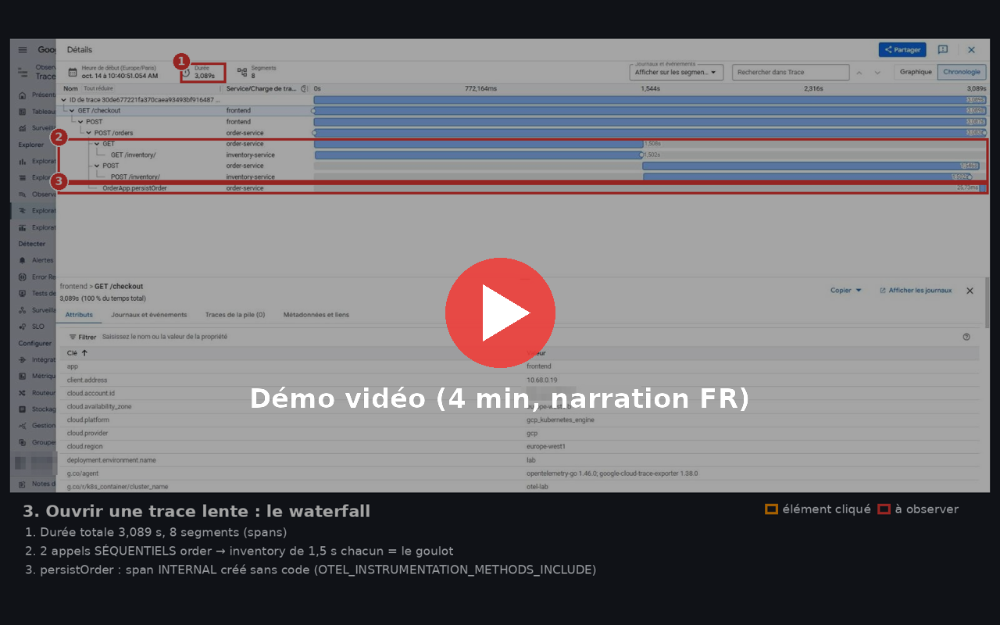

# OpenTelemetry Lab : tracing distribué sur GKE avec Cloud Trace

Lab minimaliste et reproductible pour **comprendre OpenTelemetry par la pratique** : trois microservices Java qui s'appellent en chaîne, instrumentés **sans une ligne de code OTel** (agent Java), un **OpenTelemetry Collector** qui envoie traces, logs et métriques vers **Cloud Trace**, **Cloud Logging** et **Managed Service for Prometheus**.

## Démo vidéo

[](https://www.youtube.com/watch?v=LNcq3e5FC4c)

▶ **[Voir la démo sur YouTube](https://www.youtube.com/watch?v=LNcq3e5FC4c)**. 4 min, narration en français : explorateur de traces, waterfall, attributs, erreurs, logs corrélés, percentiles, PromQL.

- Guide pas à pas avec captures annotées : [docs/USAGE.md](docs/USAGE.md).

---

## Architecture

```
                      (header W3C traceparent propagé automatiquement par l'agent)
 loadgen ──► frontend ──HTTP──► order-service ──HTTP──► inventory-service
               │                     │   (2 appels : check + reserve)  │
               └──────── OTLP/HTTP :4318 (traces + métriques + logs) ──┘
                                     ▼
                         OTel Collector (namespace otel)
       memory_limiter → filter → k8s_attributes → resource_detection → batch
                     │                     │                           │
                Cloud Trace          Cloud Logging            Managed Prometheus
                (googlecloud)        (googlecloud)          (googlemanagedprometheus)
```

| Service | Endpoint | Rôle |
|---|---|---|
| frontend | `GET /checkout?item=X&qty=N` | Point d'entrée, span racine, appelle order-service |
| order-service | `POST /orders?item=X&qty=N` | Appelle inventory 2 fois (check puis reserve), puis `persistOrder()` |
| inventory-service | `GET /inventory/{item}`, `POST /inventory/{item}/reserve` | Stock en mémoire, simule latence et erreurs |

Scénarios pilotés par l'item demandé :

| item | Effet | Ce qu'on observe |
|---|---|---|
| `laptop`, `phone`, `keyboard`, `mouse` | Nominal (201) | 8 spans, ~100-300 ms |
| `slow` | inventory met 1,5 s par appel | Trace de ~3 s, deux appels séquentiels visibles |
| `broken` | inventory renvoie 500 | Erreur sur toute la chaîne |
| `xyz` (inconnu) | inventory renvoie 404 | 4xx = erreur côté client, pas côté serveur |
| `ERROR_RATE=0.05` | 5 % de 500 aléatoires sur inventory | Erreurs imprévisibles |

## Structure du dépôt

```
.
├── services/                 3 microservices Java 21 (JDK pur, aucune dépendance) + Dockerfiles
│   ├── frontend/
│   ├── order-service/
│   └── inventory-service/
├── local/                    Test local : docker compose (services + collector + Jaeger)
│   ├── docker-compose.yaml
│   ├── otel-collector-local.yaml
│   └── smoke-test.sh
├── k8s/                      Manifests GKE (kubectl apply -k)
│   ├── kustomization.yaml    ← seul fichier à adapter (chemin des images)
│   ├── 00-namespaces.yaml
│   ├── 10-otel-collector.yaml
│   ├── 20-inventory-service.yaml
│   ├── 21-order-service.yaml
│   ├── 22-frontend.yaml
│   └── 30-loadgen.yaml
└── docs/                     Captures annotées, miniature vidéo, guide d'usage
```

## Versions utilisées

| Composant | Version |
|---|---|
| Java | 21 (images `eclipse-temurin:21`) |
| Agent Java OpenTelemetry | 2.32.0 |
| OpenTelemetry Collector (contrib) | 0.162.0 |
| Jaeger (test local) | 2.22.0 |

---

## Étape 0 : prérequis

- Un projet Google Cloud avec la facturation activée, et les droits Owner (ou équivalents) dessus.
- `gcloud`, `kubectl` (version proche de celle du cluster) et `gke-gcloud-auth-plugin`.
- Docker, pour le test local et le build des images. Sinon, utilisez Cloud Build (étape 4).

> **Cloud Shell** contient déjà tous ces outils : c'est le chemin le plus simple, quel que soit votre poste. Les commandes ci-dessous sont en **bash**. Sous Windows, utilisez Cloud Shell, WSL ou Git Bash.

Variables utilisées dans tout le guide :

```bash
export PROJECT_ID="<votre-projet>"
export REGION="europe-west1"
export ZONE="europe-west1-b"
export CLUSTER="otel-lab"
export REPO="otel-lab"
export REGISTRY="${REGION}-docker.pkg.dev/${PROJECT_ID}/${REPO}"

gcloud config set project "$PROJECT_ID"
export PROJECT_NUMBER=$(gcloud projects describe "$PROJECT_ID" --format="value(projectNumber)")
```

---

## Étape 1 : test local (optionnel, sans GCP)

Mêmes images, même agent, même collector : seul l'exporter change (Jaeger au lieu de Google Cloud).

```bash
cd local
docker compose build
docker compose up -d
./smoke-test.sh
```

- Jaeger : http://localhost:16686 → service `frontend` → **Find Traces**.
- Métriques et logs reçus par le collector : `docker compose logs -f otel-collector`.
- Arrêt : `docker compose down`.

Les JVM avec agent mettent 10 à 25 s à démarrer. Chaque réponse JSON contient le `traceparentReceived` vu par order et par inventory : le **trace-id est le même** partout, seul le span-id change à chaque saut.

---

## Étape 2 : activer les APIs

```bash
gcloud services enable \
  compute.googleapis.com \
  container.googleapis.com \
  artifactregistry.googleapis.com \
  cloudtrace.googleapis.com \
  telemetry.googleapis.com \
  monitoring.googleapis.com \
  logging.googleapis.com
```

`telemetry.googleapis.com` (API OTLP native de Google) ne sert qu'à l'expérience 8.

---

## Étape 3 : créer un cluster GKE zonal minimal

```bash
gcloud container clusters create "$CLUSTER" \
  --zone "$ZONE" \
  --num-nodes 1 \
  --machine-type e2-standard-4 \
  --disk-type pd-balanced --disk-size 50 \
  --release-channel regular \
  --workload-pool "${PROJECT_ID}.svc.id.goog"

gcloud container clusters get-credentials "$CLUSTER" --zone "$ZONE"
kubectl get nodes
```

| Choix | Pourquoi |
|---|---|
| Zonal, 1 nœud | Coût minimal : un seul control plane zonal (couvert par le crédit gratuit GKE), un seul nœud facturé |
| `e2-standard-4` | 3 JVM + collector + composants système tiennent à l'aise |
| `--workload-pool` | Active Workload Identity : le collector s'authentifie aux APIs Google **sans clé JSON** |
| (optionnel) `--spot` | Nœud préemptible, nettement moins cher ; acceptable pour un lab |

---

## Étape 4 : Artifact Registry + images

```bash
gcloud artifacts repositories create "$REPO" \
  --repository-format=docker --location="$REGION"

# Option A : build local avec Docker
gcloud auth configure-docker "${REGION}-docker.pkg.dev"
for s in frontend order-service inventory-service; do
  docker build -t "${REGISTRY}/${s}:1.0" "services/${s}"
  docker push "${REGISTRY}/${s}:1.0"
done

# Option B : sans Docker local, avec Cloud Build (activer cloudbuild.googleapis.com)
# for s in frontend order-service inventory-service; do
#   gcloud builds submit "services/${s}" --tag "${REGISTRY}/${s}:1.0"
# done
```

Sur les projets récents, le compte de service par défaut des nœuds n'a plus automatiquement le rôle Editor. Il faut lui donner le droit de lire le registre :

```bash
gcloud projects add-iam-policy-binding "$PROJECT_ID" \
  --member="serviceAccount:${PROJECT_NUMBER}-compute@developer.gserviceaccount.com" \
  --role="roles/artifactregistry.reader" --condition=None
```

---

## Étape 5 : droits IAM du collector (Workload Identity)

Le collector tourne avec le ServiceAccount Kubernetes `otel/otel-collector`. Les rôles sont donnés **directement à ce principal** (Workload Identity Federation for GKE) : pas de compte de service Google, pas d'annotation, pas de clé.

```bash
KSA="principal://iam.googleapis.com/projects/${PROJECT_NUMBER}/locations/global/workloadIdentityPools/${PROJECT_ID}.svc.id.goog/subject/ns/otel/sa/otel-collector"

for role in roles/cloudtrace.agent roles/monitoring.metricWriter roles/logging.logWriter roles/telemetry.tracesWriter; do
  gcloud projects add-iam-policy-binding "$PROJECT_ID" --member="$KSA" --role="$role" --condition=None
done
```

| Rôle | Pour |
|---|---|
| `cloudtrace.agent` | écrire les spans dans Cloud Trace |
| `monitoring.metricWriter` | écrire les métriques (Managed Prometheus) |
| `logging.logWriter` | écrire les logs |
| `telemetry.tracesWriter` | uniquement pour l'expérience 8 (OTLP natif) |

---

## Étape 6 : déploiement déclaratif

Adaptez le chemin des images dans `k8s/kustomization.yaml` (bloc `images:`). Remplacez `REGION-docker.pkg.dev/PROJECT_ID` par votre registre, à la main ou ainsi :

```bash
sed -i "s#REGION-docker.pkg.dev/PROJECT_ID#${REGION}-docker.pkg.dev/${PROJECT_ID}#" k8s/kustomization.yaml
# macOS : sed -i '' "s#...#...#" k8s/kustomization.yaml
```

Puis :

```bash
kubectl kustomize k8s/ | grep "image:"      # vérifier le rendu
kubectl apply -k k8s/

kubectl -n otel rollout status deploy/otel-collector
kubectl -n shop rollout status deploy/frontend
kubectl -n shop get pods
```

Contrôles :

```bash
# Le collector a démarré ("Everything is ready") et reçoit des lots de spans
kubectl -n otel logs deploy/otel-collector --tail=20

# L'agent est chargé dans les services ("opentelemetry-javaagent - version: 2.32.0")
kubectl -n shop logs deploy/frontend | head -5

# Le RBAC du collector fonctionne
kubectl auth can-i list pods --as=system:serviceaccount:otel:otel-collector

# Appel manuel
kubectl -n shop port-forward svc/frontend 8080:8080 &
curl "http://localhost:8080/checkout?item=laptop&qty=1"
```

Le `loadgen` (déjà déployé) envoie une requête toutes les 2 s : `kubectl -n shop logs -f deploy/loadgen`.

---

## Étape 7 : quoi observer

Laissez tourner le loadgen 3 à 5 minutes. Le parcours complet, avec captures annotées, est dans **[docs/USAGE.md](docs/USAGE.md)**.

1. **Cloud Trace → Explorateur Trace** : carte de densité (bande à ~3 s = `slow`), filtres par service, état et type de span.
2. **Une trace `slow`** : le waterfall montre deux appels **séquentiels** de 1,5 s vers inventory, plus le span `OrderApp.persistOrder`, créé uniquement par configuration de l'agent.
3. **Les attributs d'un span** : HTTP (`http.request.method`, `url.full`...), ressource (`service.*`), Kubernetes (`k8s.pod.name`, `k8s.deployment.name`...), GCP (`cloud.availability_zone`, `k8s.cluster.name`).
4. **Une trace en erreur** : on trouve le span où l'erreur naît (500 côté inventory) et on la voit remonter (502 côté frontend).
5. **Journaux et événements** d'un span : le log applicatif est rattaché à la trace grâce à `trace` et `spanId`.
6. **Affichage groupé** : P50/P90/P95 et taux d'erreur par opération.
7. **Cloud Logging** : `logName="projects/PROJECT_ID/logs/otel-lab" severity>=WARNING`.
8. **Metrics Explorer (PromQL)** :
   ```promql
   histogram_quantile(0.95, sum by (le, job) (rate(http_server_request_duration_seconds_bucket[5m])))
   ```

---

## Étape 8 : expériences

Pour chaque expérience : modifier le manifest, `kubectl apply -k k8s/`, observer.

1. **Les 4 profils de trace** : comparez `laptop`, `slow`, `broken` et `xyz`.
2. **404 vs 500.** Sur `xyz`, le span SERVER d'inventory (404) n'est pas en erreur, alors que le span CLIENT d'order l'est. C'est la convention sémantique OTel : un 4xx est la faute de l'appelant. Un 5xx est une erreur des deux côtés.
3. **Couper l'instrumentation d'un service.** Commentez `JAVA_TOOL_OPTIONS` dans `20-inventory-service.yaml`. Inventory disparaît des traces : il reçoit toujours le `traceparent`, mais personne ne le prolonge.
4. **Échantillonnage parent-based.** `OTEL_TRACES_SAMPLER_ARG: "0.1"` sur le frontend : ~10 % des traces restent, mais elles sont **complètes**. Passez ensuite inventory en `traceidratio` (sans `parentbased_`) : vous obtenez des traces trouées.
5. **Bruit des health checks.** Retirez `filter/drop-health` du pipeline traces du collector, puis `kubectl -n otel rollout restart deploy/otel-collector`.
6. **Span métier sans code** : `OTEL_INSTRUMENTATION_METHODS_INCLUDE: "lab.order.OrderApp[persistOrder,query]"`.
7. **Plus d'erreurs** : `ERROR_RATE: "0.3"` sur inventory.
8. **Export OTLP natif vers Google**, sans exporter propriétaire. L'exporter de traces `googlecloud` est annoncé en fin de vie au profit d'OTLP. Fusionnez ceci dans la config du collector :
   ```yaml
   extensions:
     health_check: { endpoint: 0.0.0.0:13133 }
     googleclientauth: {}
   processors:
     resource/gcp_project_id:
       attributes:
         - key: gcp.project_id
           value: <votre-projet>
           action: insert
   exporters:
     otlphttp/gcp:
       encoding: proto
       endpoint: https://telemetry.googleapis.com
       auth:
         authenticator: googleclientauth
   service:
     extensions: [health_check, googleclientauth]
     pipelines:
       traces:
         receivers: [otlp]
         processors: [memory_limiter, filter/drop-health, k8s_attributes, resource_detection, resource/gcp_project_id, batch]
         exporters: [otlphttp/gcp, debug]
   ```
9. **Panne du collector** : `kubectl -n otel scale deploy/otel-collector --replicas=0`. Les applications continuent de répondre ; l'agent garde une file bornée en mémoire puis jette. La télémétrie ne doit jamais casser le métier.

---

## Choix de configuration expliqués

### Instrumentation : agent Java (zéro code)
- L'agent (`-javaagent`) instrumente le bytecode au chargement :
  - spans SERVER (`com.sun.net.httpserver`) ;
  - spans CLIENT (`java.net.http.HttpClient`) avec **injection du header `traceparent`** ;
  - métriques HTTP et JVM ;
  - capture des logs `java.util.logging` avec `trace_id`/`span_id`.
- **Services en JDK pur** (pas de Spring, pas de Maven) : build Docker rapide, images légères. Sur Spring Boot, l'agent fonctionne à l'identique.
- **Agent embarqué dans l'image mais activé par le manifest** (`JAVA_TOOL_OPTIONS`) : on l'active ou le coupe par service sans rebuild. Alternative en production : l'**OpenTelemetry Operator**, qui injecte l'agent par annotation de pod.

### Variables `OTEL_*`
| Variable | Valeur | Rôle |
|---|---|---|
| `OTEL_SERVICE_NAME` | `frontend`... | `service.name`, la clé principale dans toutes les UIs |
| `OTEL_RESOURCE_ATTRIBUTES` | `service.namespace`, `service.version`, `deployment.environment.name`, `k8s.pod.name`, `k8s.pod.ip` | Attributs collés sur toute la télémétrie du process (pod et IP via la Downward API) |
| `OTEL_EXPORTER_OTLP_ENDPOINT` | `http://otel-collector.otel.svc.cluster.local:4318` | Les applications parlent au collector, jamais directement au backend |
| `OTEL_EXPORTER_OTLP_PROTOCOL` | `http/protobuf` | Défaut de l'agent 2.x ; passe mieux les proxies que gRPC |
| `OTEL_TRACES_SAMPLER` | `parentbased_traceidratio` | Le service racine décide, les autres suivent : pas de trace trouée |
| `OTEL_TRACES_SAMPLER_ARG` | `1.0` | 100 % pour le lab ; 1-10 % ou tail sampling en production |
| `OTEL_METRIC_EXPORT_INTERVAL` | `30000` | Cloud Monitoring refuse plus d'un point toutes les 5 s par série |
| `OTEL_INSTRUMENTATION_METHODS_INCLUDE` | `lab.order.OrderApp[persistOrder]` | Span INTERNAL sur une méthode, sans code |
| `OTEL_PROPAGATORS` (défaut) | `tracecontext,baggage` | Header W3C `traceparent: 00-<trace-id>-<span-id>-<flags>` |

### Pourquoi un collector
- **Découplage** : les applications ne parlent qu'OTLP. On change de backend (Jaeger en local, Google sur GKE) sans toucher aux applications.
- **Auth centralisée** : seul le collector a des droits IAM.
- **Traitements centralisés** : enrichissement, filtrage, batching, sampling.
- **Mode gateway** (Deployment + Service ClusterIP) : simple pour un lab. En production, on combine souvent un DaemonSet agent et une gateway (tail sampling).

### Processors (l'ordre compte)
1. `memory_limiter` **en premier** : refuse les données près de la limite mémoire au lieu de se faire OOMKill.
2. `filter/drop-health` : jette les spans `/health` des probes kubelet.
3. `k8s_attributes` : retrouve le pod émetteur et ajoute pod, deployment, node et namespace. Nécessite le ClusterRole en lecture seule.
4. `resource_detection` (gcp) : ajoute projet, zone et nom du cluster. **Indispensable pour Managed Prometheus**, qui exige `location` et `cluster`.
5. `batch` **en dernier** : regroupe les envois pour réduire les appels API.

### Kubernetes
- Deux namespaces : `otel` (plateforme) et `shop` (applications). Les droits IAM via Workload Identity sont ainsi limités au seul SA `otel/otel-collector`.
- **ClusterRole** (et non Role) pour le collector : il doit lire les pods de tous les namespaces.
- **ClusterIP + port-forward** : aucune exposition publique.
- **Kustomize** (`kubectl apply -k`) : un seul fichier à adapter (`images:`), manifests 100 % déclaratifs.

---

## Étape 9 : nettoyage (évite les coûts)

```bash
gcloud container clusters delete "$CLUSTER" --zone "$ZONE" --quiet
gcloud artifacts repositories delete "$REPO" --location="$REGION" --quiet

for role in roles/cloudtrace.agent roles/monitoring.metricWriter roles/logging.logWriter roles/telemetry.tracesWriter; do
  gcloud projects remove-iam-policy-binding "$PROJECT_ID" --member="$KSA" --role="$role" --condition=None
done

# Vérifier qu'il ne reste rien
gcloud container clusters list
gcloud compute disks list
```

Pour juste mettre en pause : `gcloud container clusters resize "$CLUSTER" --num-nodes 0 --zone "$ZONE"`.

## Dépannage

| Symptôme | Piste |
|---|---|
| `get-credentials` : 404 cluster not found | Le cluster n'a pas été créé (étape 3) ou mauvaise zone/projet |
| `ImagePullBackOff` | Rôle `artifactregistry.reader` du SA des nœuds (étape 4), chemin dans `kustomization.yaml` |
| Rien dans Cloud Trace | `kubectl -n otel logs deploy/otel-collector` : spans reçus ? `PermissionDenied` → étape 5 (propagation IAM : 1-2 min) |
| Pas d'attributs `k8s.*` | RBAC du collector (`kubectl auth can-i ...`) |
| Métriques absentes | API monitoring activée ? Erreurs `googlemanagedprometheus` dans les logs du collector ? Compter 2-3 min |
| Trace coupée entre 2 services | L'agent est-il chargé sur les deux ? (première ligne de log du pod) |
| `409 out of stock` après un moment | Stock en mémoire épuisé par le loadgen : `kubectl -n shop rollout restart deploy/inventory-service` |

---

*La narration de la vidéo utilise la voix de synthèse [Piper](https://github.com/rhasspy/piper) « siwis » (dataset sous licence CC-BY 4.0).*
